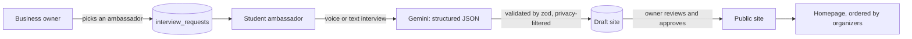

# 🚀 MH Launchpad

**Local businesses, launched by local students.**

Home-based entrepreneurs in Mountain House (bakers, tutors, tailors, notary services) rarely have a website or a printed menu.
MH Launchpad lets high-school **Tech Ambassadors** run a short multilingual interview with an owner and, with AI, instantly
publish:

- a bilingual, interactive **3D website** for the business,
- a flip-able, downloadable **3D digital business card** with a QR code,
- a printable, QR-linked **volunteer service certificate** for the student.

Owners keep control afterward: they can say *"Sold out of chicken tamales this weekend, add Atole for $5"* and the live site updates.

> **Live app:** https://mh-launchpad.vercel.app · **Code:** https://github.com/rutvikdeshpande09/mh-launchpad · **Demo video:** _add your Google Drive link here_

---

## ⚡ Try it in 3 minutes (for judges)

Everything below works with **no sign-up**, using the judge demo shortcuts.

1. **Look at real results.** Open any site under *Explore* on the homepage. Try the language toggle, tilt the 3D cards, and flip the business card.
2. **Be the student.** Go to **Ambassadors → Judge demo access**, then save a public profile (languages and a short bio).
3. **Be the business owner.** In a private window open **For businesses → Demo owner access**, enter a business name, pick your ambassador, and send the request.
4. **Run the interview.** Back as the ambassador, **accept** the request and press **Start the interview**. Type short answers (or record your voice), optionally add a *custom request* ("make it playful"), and generate. You get a private **draft** and a service certificate.
5. **Approve and polish.** Press **Approve & publish**, then open **My creations** to **Edit** the text, change the colour scheme, or tell the AI *"Sold out of X, add Y for $5."*

Prefer to verify from the terminal? `npm run smoke -- https://mh-launchpad.vercel.app` runs 19 read-only checks, and adding `--ai` runs the whole flow above.

## 🧭 Routes

| Route | What it does |
|---|---|
| `/` | Landing page and directory of businesses |
| `/ambassador` | Student sign-up (`@lammersvilleusd.net`) with a passcode and a 60-second AI-graded skill check. Then a public profile (languages, bio), the inbox of interview requests, and sign-in on any device. Judge demo toggle included |
| `/organizer` | **Website organizer** (email sign-in, allow-listed): reorder the homepage, see every unpublished site, publish, hide or delete |
| `/creations` | **My creations**: every site you interviewed for (ambassador) or own (owner), with Preview, Edit and Manage |
| `/edit/[slug]` | Manual editor for every text field in both languages (items, highlights, hours, notices). Works for the owner, or for whoever holds the private draft link while the site is still a draft |
| `/owner` | Business-owner sign-up/sign-in by email link: enter your business name, pick the ambassador who will interview you, and track your requests |
| `/interview` | 5-question interview (text or in-browser voice recording in 16 languages: English, Hindi, Telugu, Tamil, Bengali, Punjabi, Gujarati, Marathi, Kannada, Malayalam, Urdu, Spanish, Mandarin, Tagalog, Vietnamese and Korean) + photo upload → generates the site |
| `/sites/[slug]` | Public 3D business website, bilingual toggle, masked inquiry form |
| `/manage/[slug]` | Owner portal: magic-link login (or demo access), profile photo cropper, live card, colour schemes (presets or custom, auto-adjusted for readability), AI site updater, show/hide the site, private inbox |
| `/certificate/[id]` | Printable service certificate with a verification QR code |

## 🛠 Run it locally

Requires Node 20+.

```bash
git clone https://github.com/rutvikdeshpande09/mh-launchpad.git
cd mh-launchpad
npm install
cp .env.example .env.local     # then add your GEMINI_API_KEY
npm run dev                    # http://localhost:3000
```

### Environment variables

| Variable | Required | Notes |
|---|---|---|
| `GEMINI_API_KEY` | **Yes** (for AI features) | Free at <https://aistudio.google.com/apikey> |
| `GEMINI_MODEL` | No | Defaults to `gemini-3-flash-preview` |
| `NEXT_PUBLIC_SUPABASE_URL`, `NEXT_PUBLIC_SUPABASE_ANON_KEY`, `SUPABASE_SERVICE_ROLE_KEY` | No | Enables persistence, photo storage and email magic-link login |
| `APP_SECRET` | No (recommended in production) | Signs ambassador tokens |

**Without Supabase** the app still runs end to end. Data is kept in memory and resets when the server restarts, and owner login is demo-only.
**Without a Gemini key** the seeded demo sites still work, but generating or updating sites shows a clear "key not set" error.
(In local dev only, a clearly-marked mock stands in for the AI so the UI can be tested.)

### Optional: set up Supabase (free tier)

1. Create a project at <https://supabase.com>.
2. SQL Editor → paste and run [`supabase/schema.sql`](supabase/schema.sql). It creates the tables, row-level-security policies and the `business-assets` storage bucket.
3. Authentication → URL Configuration → add your site URL (and `http://localhost:3000`) to the allowed redirect URLs.
4. Copy the project URL, anon key and service-role key into `.env.local`.
5. Add yourself as a website organizer: `insert into public.organizers (email) values ('you@example.com');`

### Deploy to Vercel

```bash
npm i -g vercel
vercel            # preview
vercel --prod     # production
```

Add the same environment variables in the Vercel dashboard (Project → Settings → Environment Variables).

## 🏗 How it works



- **AI with guardrails.** Gemini returns JSON that must match a strict schema (checked again with zod), then colours and lengths are clamped. Interview text is treated as data, never as instructions. Model fallbacks keep it responsive when one model is overloaded.
- **Private by default.** New sites are drafts reachable only through a signed link. Owners can hide a site at any time. Row-level security keeps owner emails and requests server-only.
- **Roles.** Student ambassadors (school email + passcode), business owners (email link), and website organizers (allow-listed emails) each see only what they should.

## ✅ Testing

```bash
npm run dev                      # in one terminal
npm run smoke                    # in another: pages, access rules, directory privacy
npm run smoke -- http://localhost:3000 --ai   # also runs the full AI flow
```

The smoke test checks that every private endpoint refuses anonymous callers, forged tokens are rejected, the ambassador directory never leaks emails, drafts stay private until approved, and manual edits can't publish phone numbers or emails.

## 🧱 Tech stack (all free tiers)

Next.js 16 (App Router) · TypeScript · Tailwind CSS 4 · Framer Motion (3D tilt, flip, parallax) · Google Gemini via `@google/genai`
(multimodal audio transcription + strict JSON-schema output) · Supabase (Postgres, Storage, Auth) · Vercel.

## 🔒 Privacy and safety by design

- **Owners choose, nobody is assigned.** Businesses pick their own ambassador. Ambassadors appear only by first name + last initial, languages and a short bio. The owner's login email is never shown to the ambassador; only the contact detail the owner chooses to share with that one student. Demo and real accounts are kept in separate pools.
- **Custom requests.** When generating a site, the ambassador (or the owner's note) can add free-text wishes such as tone, emphasis or order. They guide the AI but can never override the privacy and honesty rules, and manual edits can't contain phone numbers or emails.
- **Drafts and an off switch.** New sites are private drafts until someone with the draft link approves them, and owners can hide their site at any time from the owner portal.
- **Consent first.** The interview can't start without confirming the owner agreed to be interviewed, to AI processing, and to a public page.
- **No private details published.** The AI is told never to output street addresses, phone numbers, emails or children's names; the public area is only "Mountain House, CA".
- **Masked inquiries.** Visitors write through the site; owners read messages only in their private portal. A honeypot field and rate limiting reduce spam.
- **Owner emails** are stored in a separate table with no public access. Students appear publicly only as *First L.*
- **No invented facts.** The AI may only use what the owner said ("Ask for details" when unknown), and all model output is validated against a strict schema and clamped before it is saved or shown.
- **Prompt-injection aware.** Interview text and audio are treated as data, never as instructions.
- **Abuse limits.** Per-IP and per-ambassador rate limits protect the free AI quota; uploads accept only small JPG/PNG/WebP images (no SVG).

## ⚠️ Honest limitations

- The service certificate is **not an official document**. Hours are an estimate and the certificate says it is *pending advisor confirmation*; a supervising adult must confirm them.
- Student email domain is checked by format only (no email verification); ambassadors sign back in with a passcode they set. The judge-demo toggle exists for evaluation.
- AI translations can contain mistakes; owners should have a fluent speaker review their site.
- In-memory mode (no Supabase) loses data on restart, and the in-memory rate limiter is per server instance.
- Demo businesses can be edited by anyone through demo owner access, by design, so judges can try the portal. Real businesses require the owner's email login when Supabase is configured.

## 📁 Project layout

```
src/app/            pages + API routes (grade-skill, generate-site, update-site, upload, inquiry, manage)
src/components/     SiteView, BusinessCard3D, Tilt, AudioRecorder, ManageClient
src/lib/            schemas (zod), gemini helper, store (Supabase/in-memory), auth, seed data
supabase/schema.sql database schema + RLS + storage bucket
```
